<!-- ⋆｡°✩ github.com/mochiicakes profile README ✩°｡⋆ -->

✦ ━━━━━━━━ ･ﾟ✧ ━━━━━━━━ ✦

### ʕ•ᴥ•ʔ about me

- 💾 Software engineer: Node.js, TypeScript, React, Next.js, PostgreSQL
- 🤖 Automation specialist: n8n workflows that connect LLM APIs, Microsoft Graph, Notion and more
- 🧸 I love building things that make life easier, without taking the fun out of it

### ⋆｡°✩ my setup ✩°｡⋆

- 🖥️ **machine:** dual-monitor PC (makes life easier)
- ⌨️ **tools:** VS Code and n8n, all dark mode
- 🧩 **must-have extensions:** Live Server (for prototyping) · Docker · Git Graph · indent-rainbow · snippets · Claude Code
- 🧭 **workflow:** clear reqs, compact code, curious tests, clean trees
- 🎧 **while coding:** J-pop, OPM, and anything with sombr / nightly / "Drag Path" energy

### (｡♥‿♥｡) projects

- 🗂️ **[yours-db](https://github.com/mochiicakes/yours-db)** · a personal database app with typed columns, bulk edits and share links · [live ✧](https://yours-db.vercel.app)
- 🐱 **[tomorrow-mobile](https://github.com/mochiicakes/tomorrow-mobile)** · a daily planning app with a once-a-day prompt and a cat companion (in development)
- 📷 **[viso-case-study](https://github.com/mochiicakes/viso-case-study)** · ten live-camera filters, each explained layer by layer
- 🎨 **[mochii-portfolio](https://github.com/mochiicakes/mochii-portfolio)** · paint-to-reveal intro, WebGL water light, recruiter + casual modes
- 📸 **[photo-bot](https://github.com/mochiicakes/photo-bot)** · a virtual photobooth in the browser · [live ✧](https://photo-bot-kappa.vercel.app)
- 🔒 **client work (private)** · backend, admin dashboard and customer app for a delivery platform; n8n automation pipelines

### ✿ most used languages ✿

<!-- generated daily by .github/workflows/metrics.yml; counts private repos -->

### ✿ live from the commit arena ✿

<!-- generated daily by .github/workflows/caster.yml from my contribution calendar -->
<picture>
  <source media="(prefers-color-scheme: dark)" srcset="caster-dark.svg" />
  
</picture>

### ✿ frameworks & libraries ✿

### ✿ platforms & tools ✿

also: n8n · Baserow · Microsoft Graph · Claude, Perplexity and Gemini APIs

<!-- ✦ reserved: portfolio preview GIF goes here once mochii-portfolio is deployed (see PROFILE_SETUP.md §5) ✦ -->

<!-- ✦ reserved: Commit Critter pet goes here once it's released ✦ -->

### ♡ when i'm not coding ♡

- 🎙️ esports host and shoutcaster since 2021
- 📱 making content
- 🌀 indulging in LOTS of hobbies

✦ ━━━━━━━━ ･ﾟ✧ ━━━━━━━━ ✦

**(ง •̀_•́)ง always eager to excel ✧**

